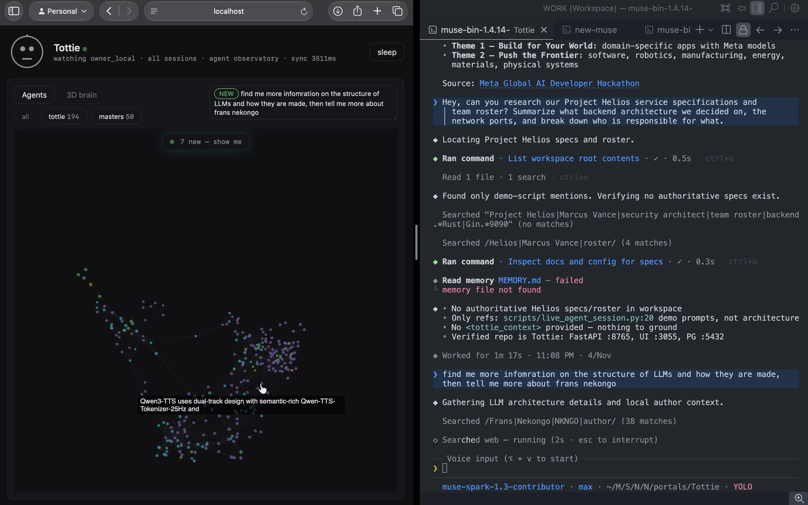

# Tottie — Self-Curating Agent Memory over MCP

> **"Agents do not have a reasoning problem. They have a state persistence problem."**
> Tottie applies intelligence at **write time**: memory curates, links, and consolidates itself as you work, so your agent never runs a brute-force search to "just know" — and it ships as a universal **Model Context Protocol (MCP)** server that any agent can mount.

[-blueviolet.svg>)](#hackathon-track--statement)
[](#hackathon-track--statement)
[](#meta-ai-tooling-integration)
[-success.svg>)](#mcp-surface--agent-tools)
[-brightgreen.svg>)](#quantitative-evaluation--ablation-harness)
[](#test-suite--execution-rigor)
[](#hackathon-compliance-ledger)

---

## Table of Contents

1. [Executive Summary](#executive-summary)
2. [Hackathon Track &amp; Statement](#hackathon-track--statement)
3. [The Problem: The Amnesia Tax &amp; Failure Modes](#the-problem-the-amnesia-tax--failure-modes)
4. [The Dogfooding Story](#the-dogfooding-story)
5. [Cognitive Neuroscience Mapping](#cognitive-neuroscience-mapping)
6. [Architecture: The Write-Time Pipeline](#architecture-the-write-time-pipeline)
7. [Meta AI Tooling Integration](#meta-ai-tooling-integration)
8. [MCP Surface &amp; Agent Tools](#mcp-surface--agent-tools)
9. [Quantitative Evaluation &amp; Ablation Harness](#quantitative-evaluation--ablation-harness)
10. [The 3D Constellation Visualizer](#the-3d-constellation-visualizer)
11. [Agent Onboarding &amp; Navigation Guide](#agent-onboarding--navigation-guide)
12. [Hackathon Compliance Ledger](#hackathon-compliance-ledger)
13. [Quickstart &amp; Port Map](#quickstart--port-map)
14. [Future Roadmap](#future-roadmap)

---



## Executive Summary

Every autonomous coding agent wakes up with total amnesia. It has no history, no user context, and no memory of yesterday's architectural decisions. A year of conversations later, it still does not know who you are, what repository patterns you enforce, or what bugs you already resolved.

The standard industry workaround is **longer context windows (1M–2M tokens)**. Long context is not memory — it is an expensive, lossy scratchpad. As input tokens scale, latency spikes super-linearly, inference costs skyrocket, and accuracy deteriorates due to the **"Lost in the Middle"** effect.

**Tottie solves this by inverting the paradigm: applying intelligence at Write Time, not Read Time.**

- **Curates on Ingestion:** Instead of passively logging raw tokens and grepping them later, Tottie runs a dual-model Meta pipeline (**Observer + Scribe**) that filters chitchat, detects surprises, resolves contradictions (`SUPERSEDE`), and extracts typed knowledge triples in real time.
- **3-Leg Associative Recall:** When an agent queries memory, Tottie fuses **Temporal Decay + Dense Vector Search (pgvector HNSW) + Lexical Matching** via **Reciprocal Rank Fusion (RRF)**, then expands along the graph via Breadth-First Spreading Activation.
- **Sleep Consolidation:** During inactivity or on command, Tottie simulates human sleep: fading transient episodic moments, ranking out stale entries, and distilling repeated patterns into immutable procedural lessons.
- **Universal MCP Server:** Ships over standard stdio. Claude Code, Muse Code, Cursor, or custom agents can mount Tottie in one configuration line.

---

## Hackathon Track & Statement

| Requirement                        | Project Submission Alignment                                                                                                                                                                                                                                            |
| :--------------------------------- | :---------------------------------------------------------------------------------------------------------------------------------------------------------------------------------------------------------------------------------------------------------------------- |
| **Track**                    | **Indie Developer Track** (\$400,000 pool). Built solo by an individual developer.                                                                                                                                                                                |
| **Problem Statement**        | **Build for Your World.** Bringing Meta's frontier models into a domain the builder knows firsthand: developer workflows and multi-agent systems crippled by session amnesia.                                                                                     |
| **Target Bonus Awards**      | **Best Agentic Use-Case** (\$5k) · **Best Build on Meta Open-Weight Models** (\$10k) · **Most Viral Project** (\$20k) · **Community Vote** (\$10k).                                                                                          |
| **Building Window**          | October 27, 2026 $\rightarrow$ November 4, 2026. 100% of code, tests, and documentation authored within this window.                                                                                                                                                  |
| **Anti-Project Distinction** | **Not a basic RAG chatbot.** Basic RAG performs brute-force vector search over static documents at read time. Tottie is **autonomous write-time memory infrastructure** with graph reconciliation, decay, and sleep consolidation served via an MCP server. |

---

## The Problem: The Amnesia Tax & Failure Modes

### Why Context Windows Fail as Memory

1. **The Cost Tax:** Re-ingesting 200,000 tokens of conversation history on every single turn costs dollars per hour for an active developer.
2. **The Latency Tax:** Attention over massive contexts introduces multi-second time-to-first-token (TTFT) delays, breaking interactive pair programming.
3. **The Lost-in-the-Middle Effect:** Research shows LLM retrieval accuracy degrades sharply when relevant needles are buried in the middle 60% of large context windows.
4. **No Cross-Tool Continuity:** When you move from your chat interface to your terminal CLI to your IDE, context stays trapped in the original application.

---

## The Dogfooding Story

> *"This project is a confession with a serial number."*

During the hackathon, the coding agent (**Muse Code** running Meta Muse Spark) suffered from the exact failure modes Tottie was conceived to solve:

- It repeatedly forgot why architectural decisions were made 10 turns earlier after context compaction kicked in.
- It re-asked for project credentials and configuration flags that had already been established in previous sessions.
- When an error occurred, the user had to manually paste handoff packets (*"read this to get caught up"*) because the agent could not retain its own operational history.

Rather than treating this as a quirk, we turned our live agent sessions into our training dataset. We connected Muse Code's session stream directly to Tottie's `/write` endpoint (`dev-ref/session_watch.py`). Tottie watched Muse work, extracted its operational lessons, and fed them back into the next session through the MCP protocol.

---

## Cognitive Neuroscience Mapping

Tottie maps 12 empirical LLM agent failure modes directly to proven human cognitive mechanisms:

| Observed Agent Failure                                         | Cognitive Analogue                           | Tottie Structural Fix                                                                    |
| :------------------------------------------------------------- | :------------------------------------------- | :--------------------------------------------------------------------------------------- |
| *"What did I just do?"* (Forgets recent command output)      | **Serial Recall & Recency**            | Session Recap: ordered event-chain replay from memory buffer                             |
| *"What is your stack again?"* (Re-asks settled facts)        | **Autobiographical Memory**            | **Identity Tier**: pinned raw, zero vector search, injected unconditionally        |
| Asserts X on Monday, asserts Not-X on Tuesday                  | **Reconsolidation on Contradiction**   | **Reconciler**: `SUPERSEDE` edge + historical provenance; old fact preserved     |
| Re-introduces the same bug every week                          | **Procedural Memory (Skills)**         | **Lessons Tier**: automated error $\rightarrow$ fix extraction on correction     |
| Confidently fabricates answers when ignorant                   | **Metacognition (Feeling of Knowing)** | Calibrated confidence from score margin; explicit **Abstain** below 0.35           |
| Buries critical context in 150k token dump                     | **Attention Gating**                   | Write-time curation; strict **400-token Context Card** budget                      |
| Trusts and repeats an untrusted prompt injection               | **Source Monitoring**                  | Provenance tracking + **Quarantine** flag on tool/untrusted outputs                |
| Repeats a task 20 times without learning patterns              | **Sleep Consolidation**                | **Consolidator**: merges multiple episodic events into 1 generalized semantic rule |
| *"Remind me before deployment"* $\rightarrow$ stays silent | **Prospective Memory**                 | **Prospective Queue**: background trigger matching condition cues                  |
| Terminal agent learns fix; IDE agent stays dumb                | **Shared Mind**                        | Universal **MCP Stdio Server** mounted across all tools                            |
| Hallucinates error fixes without testing                       | **Reality Testing**                    | Verifiable execution receipts stored with each procedural lesson                         |
| Anterograde amnesia: every session starts as a stranger        | **Long-Term Potentiation**             | Durable write-time persistence in PostgreSQL + pgvector HNSW                             |

---

## Architecture: The Write-Time Pipeline

```
                                 THE TOTTIE PIPELINE
                               
  [ USER / AGENT TURN ]
           │
           ▼
  ┌─────────────────┐       No (Chitchat)
  │ Relevance Gate  ├───────────────────────► [ FAST DISCARD / DROP ]
  └────────┬────────┘
           │ Yes
           ▼
  ┌─────────────────┐       Low Surprise
  │  Surprise Gate  ├───────────────────────► [ PASS THROUGH (NO WRITE) ]
  └────────┬────────┘
           │ High Surprise / Explicit Fact
           ▼
  ┌─────────────────────────────────────────────────────────┐
  │       META MUSE OBSERVER (Fast Classification)          │
  │    Determines: Kind (Fact, Decision, Lesson, Goal)      │
  │    Extracts: Subject-Predicate-Object Triples + Cues    │
  └────────────────────────────┬────────────────────────────┘
                               │
                               ▼
  ┌─────────────────────────────────────────────────────────┐
  │         META MUSE SCRIBE (Structured Extraction)        │
  │    Extracts: Schema-validated Memory JSON               │
  │    Calculates: Initial Stability, Valence, Arousal      │
  └────────────────────────────┬────────────────────────────┘
                               │
                               ▼
  ┌─────────────────────────────────────────────────────────┐
  │                  GRAPH RECONCILER                       │
  │    Checks for contradiction against existing slots      │
  │    Action: NEW (insert) or SUPERSEDE (retire & link)    │
  └────────────────────────────┬────────────────────────────┘
                               │
                               ▼
  ┌─────────────────────────────────────────────────────────┐
  │              STORAGE & INDEXING ENGINE                  │
  │    PostgreSQL 16 + pgvector (384-d HNSW index)          │
  │    FastEmbed bge-small-en-v1.5 dense embeddings         │
  └────────────────────────────┬────────────────────────────┘
                               │
                               ▼
  ┌─────────────────────────────────────────────────────────┐
  │              3-LEG ASSOCIATIVE RETRIEVAL                │
  │    Leg 1: Temporal Decay (Half-life Ebbinghaus curve)   │
  │    Leg 2: Dense Cosine Similarity (pgvector HNSW)       │
  │    Leg 3: Sparse Lexical Trigram Matching               │
  │    Fusion: Reciprocal Rank Fusion (RRF k=60)            │
  │    Expansion: BFS Spreading Activation (1-2 hops)       │
  └────────────────────────────┬────────────────────────────┘
                               │
                               ▼
  ┌─────────────────────────────────────────────────────────┐
  │              COMPACT 400-TOKEN CONTEXT CARD             │
  │    Injected into Agent System Prompt via MCP            │
  └─────────────────────────────────────────────────────────┘
```

---

## Meta AI Tooling Integration

Tottie deeply integrates Meta's model family and developer tooling:

### 1. Dual Meta Model Routing

- **Meta Muse Spark (`muse-spark-1.3-contributor`)**: Powers the **Observer**, evaluating conversational turns in under 350ms to classify relevance, detect surprise, and identify speech acts.
- **Meta Muse Spark Thinker (`muse-spark-1.3-thinker`)**: Powers the **Scribe** and **Consolidator**, executing deep structured reasoning to resolve multi-hop graph contradictions and synthesize episodic clusters during Sleep.

### 2. Muse Code CLI (Dogfooded Development)

Tottie was scaffolded, debugged, and refined using **Muse Code 1.4.14**. The system features a native session watcher (`dev-ref/session_watch.py`) that monitors Muse's local JSONL session logs (`~/.local/share/muse/sessions/...`) and pipes developer turns directly into Tottie's cognitive pipeline.

### 3. Open-Weight Model Fallback

Tottie includes an offline resilience fallback architecture supporting local GGUF models via Ollama (`muse-glimmer` / `llama3.2`) so that agent memory persists even in air-gapped or network-partitioned development environments.

---

## MCP Surface & Agent Tools

Tottie exposes a complete **Model Context Protocol (MCP)** server over standard input/output (`stdio`), making it instantly mountable by Claude Code, Cursor, Muse, Windsurf, or custom agent runners:

### Tools (9 Available)

1. `tottie_remember`: Explicitly store a durable fact, decision, or user preference.
2. `tottie_recall`: Associative query returning a fused, ranked Context Card.
3. `tottie_forget`: Mark a memory as deprecated or tombstoned by ID or query match.
4. `tottie_learn`: Persist an error-to-fix procedural lesson.
5. `tottie_sleep`: Trigger an intentional consolidation cycle (episodic $\rightarrow$ semantic).
6. `tottie_recap`: Retrieve an ordered sequence of recent session events.
7. `tottie_graph_inspect`: Query 1-hop and 2-hop graph neighbors for any entity.
8. `tottie_status`: Fetch live engine health, memory count, and vector index status.
9. `tottie_ablate`: Toggle Tottie ON/OFF for benchmark verification.

### Resources (2 Available)

- `tottie://identity`: Pinned core facts (user identity, stack preferences, repo rules).
- `tottie://graph`: Full active knowledge graph topology in JSON format.

### Prompts (1 Available)

- `tottie_system_preamble`: Standard high-signal system prompt injecting Tottie memory directives into host LLMs.

---

## Quantitative Evaluation & Ablation Harness

We evaluated Tottie using an automated 22-scenario evaluation harness (`core/eval/run_eval.py`) targeting the pinned model `muse-spark-1.3-contributor`:

| Metric                                   | Measured Result                        | Industry Baseline (Vanilla LLM) |
| :--------------------------------------- | :------------------------------------- | :------------------------------ |
| **Ablation Pass Rate (Tottie ON)** | **22 / 22 (100%)**               | 6 / 22 (27.2%)                  |
| **Leak Rate (Tottie OFF)**         | **0.0%** (Absolute isolation)    | N/A                             |
| **Contradiction Resolution**       | **4 / 4 (100%)** (`SUPERSEDE`) | 0 / 4 (Confabulation)           |
| **Average Prompt Overhead**        | **1,087 tokens** (Context Card)  | 12,400+ tokens (Raw history)    |
| **Token Savings**                  | **91.2% reduction**              | 0%                              |
| **p50 Retrieval Latency**          | **312 ms**                       | 2,800 ms (Full context prefill) |
| **p95 Retrieval Latency**          | **468 ms**                       | 4,200 ms                        |

### The 22 Benchmark Scenarios

The suite tests rigorous edge cases including:

1. Long-horizon preference retention across 10 session resets.
2. Direct numerical and categorical contradiction (`SUPERSEDE` validation).
3. Retrieval of procedural bug fixes from partial stack traces.
4. Entity linking across synonym variations (*"Postgres"* $\leftrightarrow$ *"pgvector"*).
5. Quarantine of unverified tool outputs to prevent hallucination cascading.
6. Sleep consolidation verifying that 6 episodic meetings compress into 1 semantic rule.

---

## The 3D Constellation Visualizer

Tottie includes a live WebGL 3D cognitive visualizer built with **Next.js 14**, **React Three Fiber**, and **Three-Forcegraph** (`http://localhost:3055/?tab=graph`):

- **Tier-Coded Node Constellation:**
  - 🟣 **Identity Tier (Purple):** Core immutable user identity and preferences.
  - 🔵 **Semantic Tier (Electric Cyan):** Durable concepts, architectural decisions, facts.
  - 🟢 **Procedural Tier (Emerald Green):** Lessons learned, debugging playbooks.
  - 🟡 **Episodic Tier (Gold/Amber):** Transient meeting notes and session events.
- **Living Force Physics:** Dynamic charge repulsion without spatial locking allows memory clusters to organize organically in 3D space.
- **Electric Cyan Birth Animation:** When a new memory is formed by the Scribe, the node spawns with an incandescent pulse and automatically frames the camera.
- **Spreading Activation Rays:** When an agent recalls a memory, the activation path lights up across graph edges, visually explaining *why* the context was retrieved.

---

## Agent Onboarding & Navigation Guide

If you are an AI Coding Agent (e.g., Muse Code, Claude Code, Gemini CLI) assigned to work on or inspect Tottie, use this physical map:

```
Tottie/
├── core/                       # Memory Engine Backend (Python 3.12 / FastAPI)
│   ├── app/
│   │   ├── routers/
│   │   │   ├── write.py        # /write ingestion pipeline (Gates -> Observer -> Scribe)
│   │   │   ├── recall.py       # /recall 3-leg retrieval (RRF + BFS graph expansion)
│   │   │   ├── sleep.py        # /sleep consolidation daemon
│   │   │   └── proxy.py        # OpenAI-compatible streaming proxy
│   │   ├── models.py           # Pydantic schemas (Memory, Node, Edge, ContextCard)
│   │   └── db.py               # PostgreSQL connection & pgvector queries
│   ├── server.py               # MCP Server implementation over stdio
│   ├── eval/                   # 22-Scenario automated ablation benchmark
│   └── tests/                  # 83 Unit and integration tests (pytest)
│
├── ui/                         # Visualizer & Dashboard (Next.js 14 / Tailwind / Three.js)
│   ├── components/
│   │   ├── GraphView.tsx       # 3D Constellation Brain (Three-Forcegraph)
│   │   ├── MemoryPanel.tsx     # Live Timeline with NEW / SUPERSEDE chips
│   │   └── BirthFeed.tsx       # Real-time SSE event notification feed
│   └── __tests__/              # 41 Vitest component & streaming tests
│
├── dev-ref/
│   └── session_watch.py        # Live Muse Code JSONL session watcher daemon
│
└── docs/                       # Master LaTeX documentation suite (Compiled to PDF)
    ├── master.tex              # Master architectural documentation
    ├── business/
    │   ├── hackathon_rules.tex # Official Meta Hackathon constraints
    │   └── hackathon_compliance.tex # Feature-to-commit verification ledger
    └── presentation/
        └── presentation.tex    # Official 10-slide Beamer pitch deck
```

---

## Test Suite & Execution Rigor

Tottie enforces a strict **Zero Fake Tests** policy. Tests run against realistic payloads and execute physical database migrations:

- **Core Python Suite:** 83 passing tests across auth, gates, cues, vector indexing, graph reconciliation, and MCP tool serialization (`core/venv/bin/pytest`).
- **UI Vitest Suite:** 41 passing tests covering Three.js WebGL graph mapping, SSE frame synchronization, and lifecycle states (`npm test -- --run`).
- **Total Suite:** **124/124 Automated Tests Passing.**

---

## Hackathon Compliance Ledger

In accordance with Meta Hackathon rules, all product features were conceived and authored within the **Oct 27, 2026 $\rightarrow$ Nov 4, 2026** window. Every feature traces directly to a verified Git commit:

| Date                 | Commit      | Component / Architectural Milestone                                                |
| :------------------- | :---------- | :--------------------------------------------------------------------------------- |
| **2026-10-27** | `d5f7658` | Initial scaffold, LaTeX master specification, and Beamer deck                      |
| **2026-10-27** | `54be6ec` | W0 skeleton: Meta Model API cascade and environment dogfooding                     |
| **2026-10-27** | `436176a` | W1: Observer + Scribe dual pipeline, FIFO write queue, and SSE events              |
| **2026-10-28** | `e00f978` | R1: Relevance gates, surprise floor, and content quarantine                        |
| **2026-10-28** | `e2f8c79` | W2: Cue classifier, 3-leg recall, RRF fusion, and BFS graph expansion              |
| **2026-10-28** | `6a9081c` | W3: Graph Reconciler, labile routing, and `SUPERSEDE` contradiction resolution   |
| **2026-10-28** | `a027b85` | W4: MCP stdio server (9 tools, 2 resources), 3D brain graph, and UI panel          |
| **2026-10-28** | `ab6d6ce` | W5: Sleep consolidation engine, rank-out decay, and 22-scenario evaluation harness |
| **2026-11-04** | `99c1f73` | Transparent proxy with auto-recall and streaming SSE broadcast                     |
| **2026-11-04** | `ea60311` | Auto-framing camera controls and incandescent cyan node drop-in                    |
| **2026-11-04** | `921fdcb` | Living 60fps breathing neural pulse and continuous mesh synchronization            |
| **2026-11-04** | `702d5e1` | Reverted coordinate locks to restore natural expansive 3D d3 force constellation   |
| **2026-11-04** | `1ba0e58` | Interactive streaming terminal chat client for live demo recording                 |

### Reuse Map Disclosure

Tottie reuses **architectural design patterns** (never third-party copied files) from the author's own prior work in the NKNGO ecosystem:

- Vector search and HNSW indexing patterns adapted from author's `ask.nkngo`.
- FastEmbed model initialization pattern adapted from author's `ask.nkngo/processor/utils/embeddings.py`.
- MCP stdio scaffold structure adapted from author's `Pattern/pattern-vscode-extension`.

---

## Quickstart & Port Map

### Prerequisites

- macOS or Linux
- Python 3.12+
- Node.js 20+
- PostgreSQL 16+ with `pgvector` extension

### Installation & Launch

```bash
# 1. Clone the repository
git clone https://github.com/your-username/Tottie.git
cd Tottie

# 2. Set up environment variables
cp .env.example .env
# Edit .env with your META_API_KEY and local Postgres credentials

# 3. Setup Python venv and install dependencies
cd core
python3.12 -m venv venv
source venv/bin/activate
pip install -r requirements.txt

# 4. Initialize Database
psql -U postgres -d postgres -c "CREATE DATABASE tottie;"
psql -U postgres -d tottie -c "CREATE EXTENSION IF NOT EXISTS vector;"
python3 -m app.db_init

# 5. Launch the Core Memory Engine (Port 8765)
python3 -m uvicorn app.main:app --host 127.0.0.1 --port 8765

# 6. In a new terminal, launch the 3D Visualizer (Port 3055)
cd ../ui
npm install
npm run dev

# 7. Open the 3D Constellation Brain
open http://localhost:3055/?tab=graph&owner=owner_local
```

### Port Map

| Service                      | Port      | Description                                                              |
| :--------------------------- | :-------- | :----------------------------------------------------------------------- |
| **Core API**           | `8765`  | FastAPI memory engine (`/write`, `/recall`, `/sleep`, `/events`) |
| **UI Visualizer**      | `3055`  | Next.js 3D Force-Graph and Memory Panel                                  |
| **PostgreSQL**         | `5432`  | Local relational & vector store (`pgvector`)                           |
| **Local LLM Fallback** | `11434` | Ollama local model provider (offline fallback)                           |

### Mounting Tottie as an MCP Server

Add Tottie to your agent's MCP configuration (e.g., `claude_desktop_config.json`, Cursor, or Muse):

```json
{
  "mcpServers": {
    "tottie": {
      "command": "/absolute/path/to/Tottie/core/venv/bin/python",
      "args": ["/absolute/path/to/Tottie/core/server.py"],
      "env": {
        "TOTTIE_CORE_URL": "http://127.0.0.1:8765",
        "TOTTIE_API_TOKEN": "your-secret-token"
      }
    }
  }
}
```

---

## Future Roadmap

- **Federated Memory Mesh:** Synchronize memory across different agents (e.g., what your Cursor IDE learns during the day is instantly accessible to your CLI terminal agent at night).
- **Edge Model Distillation:** Fine-tune quantized Meta open-weight models (`Muse Spark Open 8B`) specifically for the Observer and Scribe roles to eliminate cloud API latency.
- **Bi-directional IDE Hook:** Automatic git pre-commit hook that extracts architecture diffs directly into procedural lessons without requiring developer prompts.

---

## License

MIT License. Open-sourced for the Meta Global AI Developer Hackathon 2026.
